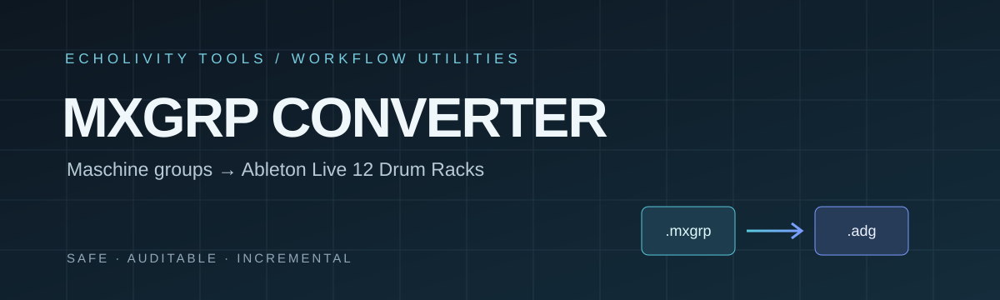

\n\n<div align="center">\n\n\n\n</div>

<div align="center">

# MXGRP Batch Converter

**Maschine kits → Ableton Live 12 Drum Racks.**

A safe, audited batch converter for Native Instruments Maschine `.mxgrp` groups and Ableton `.adg` presets.

[Features](#what-it-does) · [Install and run](#install-and-run) · [Results](#real-library-results) · [Verification](#verification-and-limitations)


</div>

## At a glance

- Converts Maschine `.mxgrp` groups into Ableton Live 12 Drum Rack `.adg` presets.
- **Dry-run first**, with CSV reports and logs before writing presets.
- Validates generated racks before atomic writes.
- Uses SHA-256 change detection for safe incremental runs.
- Preserves pad order and reports unsupported plugin/drum-synth content instead of silently dropping it.

> **Safety:** The converter never modifies or deletes source files and never overwrites existing outputs unless `--overwrite` is passed. Use your own Maschine libraries and Ableton *Drum Essentials* pack. The required template is `Wrong Sided Kit.adg`. This repository contains no Native Instruments or Ableton content.

> Not affiliated with or endorsed by Native Instruments or Ableton. The `.mxgrp` format is reverse-engineered and may change.

## What it does

```text
Maschine library (.mxgrp)
        │
        ▼
Discovery + structured parsing
        │
        ▼
Sample / plugin checks ──► CSV report + log
        │
        ▼
Ableton Drum Essentials template
        │
        ▼
Generate .adg ──► Re-read + validate ──► Atomic write
```

## Install and run

**Requirements:** Windows-tested; Python 3.8+; standard library only. Ableton Live 12 and the *Drum Essentials* pack are needed to use the generated racks.

1. Download or clone this repository.
2. Locate `Wrong Sided Kit.adg` from your Ableton *Drum Essentials* pack.
3. Open PowerShell in the folder containing `batch_convert.py`.

### 1. Optional tests

```powershell
$env:MXGRP_3ONIT = "H:\Maschinelib\Amplified Funk Library\Groups\Kits\3onIt Kit.mxgrp"
$env:MXGRP_TEMPLATE = "D:\abpcks\Drum Essentials\Drums\Hybrid\Wrong Sided Kit.adg"
python -m unittest discover -s tests -v
```

### 2. Dry-run the library first

This writes reports and logs, **not** `.adg` presets.

```powershell
python batch_convert.py "H:\Maschinelib" "D:\NI Drum Racks" `
  --template "D:\abpcks\Drum Essentials\Drums\Hybrid\Wrong Sided Kit.adg" --dry-run --report ".\reports"
```

### 3. Convert

Review the dry-run report, then execute:

```powershell
python batch_convert.py "H:\Maschinelib" "D:\NI Drum Racks" `
  --template "D:\abpcks\Drum Essentials\Drums\Hybrid\Wrong Sided Kit.adg" --execute --report ".\reports"
```

For a single regression kit:

```powershell
python batch_convert.py "H:\Maschinelib" "D:\NI Drum Racks" `
  --template "D:\abpcks\Drum Essentials\Drums\Hybrid\Wrong Sided Kit.adg" --execute --only "3onIt Kit" --report ".\reports"
```

### Options

| Flag | Purpose |
|---|---|
| `--dry-run` | Discover, validate and report without writing racks |
| `--execute` | Perform conversion |
| `--overwrite` | Replace existing or stale outputs |
| `--only TEXT` | Process matching kit(s) only |
| `--accept-short-kits` | Allow kits with fewer than 16 pad records |
| `--accept-parse-warnings` | Continue despite parse warnings |
| `--allow-missing-samples` | Permit missing sample references |
| `--no-previews` | Disable previews |
| `--no-xmp` | Disable XMP output |

## Real-library results

**Full execution on the author's Windows Maschine library:** 5,462 `.mxgrp` files; zero errors.

| Result | Kits |
|---|---:|
| Converted — all 16 pads are samples | 2,859 |
| Converted partial — sample pads converted; unsupported plugin/drum-synth pads left empty | 2,147 |
| Skipped — already up to date | 49 |
| Skipped — multizone instrument | 211 |
| Skipped — no supported sample pads | 177 |
| Held for short-kit review | 19 |
| **Total racks written** | **5,055** |

The 5,055 written racks matched the dry-run prediction exactly. These are reported results from the author's library run, not a claim that every rack was individually auditioned.

## What changed vs upstream

Based on [`24407kt/mxgrp-to-drumrack`](https://github.com/24407kt/mxgrp-to-drumrack) (MIT). The upstream `.adg` template-generation technique is retained; the original generator remains as `generate_drum_rack_adg_legacy` for regression comparison.

1. **Pad 10–12 rotation fixed.** The root cause was generator template branch order, not the parser. Branch selection is now based on `ReceivingNote`.
2. **Structured parser.** Reads sound records (name, instrument, sample) in serialized order; reused samples do not shift pads.
3. **Unsupported plugin pads reported.** Massive and other plugin pads are reported as `UNSUPPORTED_PLUGIN`, never silently dropped.
4. **Template branches cleaned.** Unused branches are removed, IDs renumbered 0..n−1, and pad labels use Maschine pad names.
5. **RIFF-aware WAV reader.** Walks chunks including LIST, bext and extensible; detects truncated or corrupt files.
6. **Missing/corrupt samples block output** unless `--allow-missing-samples` is explicitly passed.
7. **No silent truncation.** More than 16 sounds is an error; fewer than 16 records are held for review by default.
8. **Validate before writing.** Generated XML is re-read and checked for pad count, notes and sample references. Writes are atomic.
9. **Content-based change detection.** SHA-256 covers source, template, converter/parser versions, sample root and options—not modification times. A manifest is stored in each output folder.

## Verification and limitations

### Verified against Maschine and Live 12

- **3onIt Kit:** pads 10–12 = Sidestick / Tom / Vocal; rack loads in Live 12.
- **Cachophony Kit** and **Amplified Funk “Chakra Kit”:** sample pads retain the same MIDI notes/pad numbers as Maschine; unsupported synth/plugin pads are empty.
- **DaOne Kit:** a sample name containing a double space was matched by the whitespace-normalized unique fallback and recorded in the report.

### Automated tests

The Linux sandbox test run used the real 3onIt group and real template with synthetic silent WAVs. The reported suite: **9 tests, OK**. Coverage includes parser order/names/plugin detection, the pad 10–12 regression, XML escaping, dry-run safety, execute + ADG verification, Massive reporting, second-run skip/stale handling, missing/corrupt samples and extensible WAV reading.

### Not verified

- Push 2 pad layout; the converter cannot run Ableton or a Push controller.
- Only a few racks were opened in Live. The remaining ~5,000 are structurally validated (XML re-parsed, branch count, notes and paths), not individually auditioned.
- Pad numbering for the 19 short kits and the four `Groups\Kits` Rhodes multizone kits remains unverified.

### Known limitations

- **Short kits (19 held):** 16 are real kits with fewer than 16 pad records; 3 are Multi FX groups. `--accept-short-kits` assumes pads 1..N; verify in Maschine first. One kit references an uninstalled Community Drive 2021 library.
- **Multizone instruments (211 skipped):** 207 are `Groups\Loops`; 4 are Rhodes kits. A single multizone sampler is not a Drum Rack.
- **Plugin and Maschine drum-synth pads:** reported as unsupported and left empty. NI effects are ignored and do not block conversion.
- Pad → MIDI assumes note 36 + index (Maschine default); custom note maps are not read.
- Multizone samplers on a normal kit use the first zone only (warned in the report).
- Sample names match exactly, then by a unique whitespace-normalized match in the same folder.
- Volume, pitch, envelope and effect settings are not converted. `DefaultSampleRate` remains as in the template (44.1 kHz).
- `BrowserContentPath` retains the template's existing string.
- Uncertain name-sequence parsing is held as `REVIEW_PARSE_UNCERTAIN` rather than guessed.

## Project files

| File | Purpose |
|---|---|
| `batch_convert.py` | Main entry point: discovery, validation, dry-run/execute, manifest, CSV reports and logs |
| `mxgrp_parser.py` | Structured `.mxgrp` record parser |
| `mxgrp_to_drumrack.py` | Patched upstream generator, note-addressed ADG generation, RIFF reader and validator |
| `tests/test_regression_3onit.py` | 3onIt regression tests |
| `FORMAT_NOTES.md` | Reverse-engineered format notes and unknowns |

## Licence and attribution

This project is licensed under the **MIT License**. See [`LICENSE`](LICENSE).

Based on [`24407kt/mxgrp-to-drumrack`](https://github.com/24407kt/mxgrp-to-drumrack), also MIT-licensed. The original upstream technique is retained and adapted; see the repository history and source for details.

---

<div align="center">

**ECHOLIVITY TOOLS** · Built for hands-on music making.

</div>
